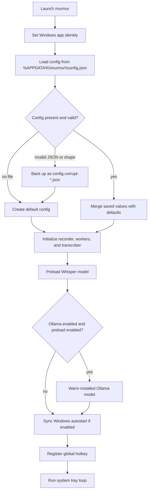

# Getting Started

murmur is a Windows-first desktop application. It records microphone audio,
keeps the complete recording in memory, performs local Whisper transcription,
and copies the final text to the system clipboard. The live VAD and
transcription workers reduce the amount of work left after the stop hotkey, but
the full recording remains available as a fallback.

## Requirements

| Requirement | Purpose | Required? |
| --- | --- | --- |
| Windows 10 or 11 | Global hotkeys, tray integration, and Windows media/notification features | Yes |
| Python 3.12 | Supported runtime | Yes |
| Microphone | Audio capture through `sounddevice` | Yes |
| NVIDIA GPU and CUDA-enabled PyTorch | Faster Whisper inference | Optional; CPU fallback is supported |
| Ollama server and configured model | Final punctuation/correction pass | Optional; local cleanup remains available |

murmur's Whisper inference is local after the model is available. Installing
Python packages and downloading a Whisper model may require internet access.
Ollama defaults to `http://localhost:11434`; configuring a remote Ollama
endpoint sends the final transcript to that endpoint.

## Install

Run these commands from a PowerShell window in the repository root:

```powershell
py -3.12 -m venv venv
venv\Scripts\python.exe -m pip install --upgrade pip
```

For an NVIDIA GPU, install the CUDA-enabled PyTorch wheel recommended by the
[official PyTorch selector](https://pytorch.org/get-started/locally/) before
installing murmur. The repository only requires `torch`; the exact CUDA wheel
depends on the driver and Python environment.

```powershell
venv\Scripts\python.exe -m pip install torch --index-url https://download.pytorch.org/whl/cu121
```

Then install murmur and its development tools:

```powershell
venv\Scripts\python.exe -m pip install -e ".[dev]"
```

For CPU-only use, skip the CUDA command and let the editable install resolve
the PyPI Torch dependency. Confirm a CUDA setup before launching if GPU use is
expected:

```powershell
venv\Scripts\python.exe -c "import torch; print('torch', torch.__version__); print('cuda build', torch.version.cuda); print('cuda available', torch.cuda.is_available()); print('gpu', torch.cuda.get_device_name(0) if torch.cuda.is_available() else 'n/a')"
```

## Optional Ollama setup

Ollama is enabled by default, but it is not required for the core
record-transcribe-copy workflow. Install Ollama separately and pull the model
matching the default settings:

```powershell
ollama pull qwen3.5:4b
```

Start Ollama using its desktop service or with `ollama serve`. If the service,
model, or request is unavailable, murmur keeps the locally cleaned transcript
and continues finalization. Use **Settings > LLM Cleanup > Test Ollama
Connection** to check an endpoint and model.

## Launch

The supported launch options all call the same `src.main:main` entry point:

```powershell
# Visible console
venv\Scripts\python.exe run.py

# Background process without a console window
venv\Scripts\pythonw.exe run.py

# Installed console script
venv\Scripts\murmur.exe

# Python module form
venv\Scripts\python.exe -m src
```

`run_background.vbs` is the convenience launcher for the background mode. It
prefers `venv\Scripts\pythonw.exe` for source development, then uses
`dist\murmur\murmur.exe` when a packaged build exists, and finally falls back
to `pythonw.exe` from `PATH`.

A non-editable installation (`python -m pip install .` or a built wheel) can
launch with `murmur` or `python -m src` from outside the repository. The runtime
logo is included at `src/resources/icon.png`. Python-mode **Start with Windows**
uses the installed environment's `pythonw.exe -m src`; the frozen release uses
its executable. Source development autostart requires the editable install above.

## Build a packaged release

The packaged release keeps the Python source workflow above unchanged while
providing a standalone Windows application folder. Build it from the repository
root with PowerShell:

```powershell
powershell -ExecutionPolicy Bypass -File .\build_windows.ps1
```

The script installs the pinned PyInstaller dependency into `venv`, generates
Windows icon and version resources, builds murmur, and runs a packaged dependency
self-check. The first build can take several minutes because Whisper, Torch, and
their native libraries are analyzed.

The release is written to `dist\murmur\`. Keep that directory together when
copying or distributing the application. For a manual per-user installation,
copy or extract the complete folder to:

```text
%LOCALAPPDATA%\Programs\murmur
```

Launch `murmur.exe` from that folder. Do not move the executable out of the
folder or distribute it by itself. An optional Desktop shortcut can point to
`murmur.exe` while leaving the application files together. The **Start with
Windows** setting in murmur controls automatic launch and does not require a
Desktop or Start Menu shortcut.

End users do not need a separate Python or FFmpeg installation. The first
launch can download the configured Whisper model if it is not already in the
user's cache.

For repeat local builds after dependencies are installed, skip the install step:

```powershell
powershell -ExecutionPolicy Bypass -File .\build_windows.ps1 -SkipInstall
```

For maintainers investigating a packaged app that fails to load its model,
see [Diagnose packaged model loading](troubleshooting.md#diagnose-packaged-model-loading-maintainers).

## First launch



The first launch downloads the selected Whisper model if it is not already in
Whisper's user cache. Ollama warmup checks for an installed model but does not
download one. If the configured hotkey is invalid or cannot be registered,
murmur attempts to reset it to the default `ctrl+shift+space`; an unrecoverable
registration failure stops startup.

## Record a transcript

1. Wait for the murmur icon in the Windows system tray.
2. Press `Ctrl+Shift+Space` (or the configured hotkey) to start a recording.
3. Wait for the pill's three pulsing bars above the taskbar, then speak normally.
   If the overlay is disabled, wait for `Recording...` in the tray menu.
4. Press the hotkey again to stop. The pill switches to a loading spinner.
   The configured maximum duration also stops recording automatically.
5. Wait for processing to finish and the text to be copied. With the overlay
   enabled, the pill shows `Copied to clipboard`.
6. Paste with `Ctrl+V` in the target application.

Pauses in your speech do not stop the recording; use the hotkey when you are done.

### Cancel or exit

If you change your mind before recording starts, press the hotkey again to
cancel the pending recording. Preparation can take a moment while murmur checks
and pauses media, if that setting is enabled.

During recording or processing, click the pill's **X** or choose **Cancel
dictation** from the tray menu to discard the dictation. Choosing **Exit** also
discards unfinished dictation, restores playback murmur paused, and quits.

Cancelled dictation leaves your clipboard unchanged and is not saved to training
data. If result delivery has already begun, it may still finish copying and
saving. An active model call can delay the next recording or quitting. See
[Cancellation](pipeline.md#cancellation) for the detailed behavior.

### Recording feedback

The recording pill appears after the microphone starts successfully. A failed
start shows a short error instead. Other errors, such as `No speech detected`,
also appear in the pill.

The overlay does not take focus. Turn it off with **Settings > General > Show
recording overlay**. With it disabled, the tray status changes from
`Preparing...` to `Recording...` when capture starts. Windows toast notifications
are off by default and can be enabled separately with **Enable notifications**.

If you enable notifications, run this once to show the murmur icon on Windows
toasts:

```powershell
venv\Scripts\python.exe tools\register_toast_icon.py
```

Run it again after changing `app/toast-icon.png`. Add `--remove` to remove the
registered icon.

## Development checks

The project uses Ruff and pytest. With the repository virtual environment:

```powershell
venv\Scripts\python.exe -m pip install -e ".[dev]"
venv\Scripts\ruff.exe format --check .
venv\Scripts\ruff.exe check .
venv\Scripts\pytest.exe
```

After changing Python packaging or launch paths, also run:

```powershell
venv\Scripts\python.exe tools\check_wheel_install.py
```

This builds a wheel, checks its runtime files, and installs it into a temporary
virtual environment outside the checkout. It runs `tools/check_installed_wheel.py`
with that environment's isolated interpreter to verify module and console launch
dispatch, the autostart command, logo loading, and ICO generation. Only Pillow
is installed alongside the wheel; the desktop runtime is replaced for this
check, so it does not start recording, register hotkeys, or write the registry.
Building and installing may require package-index access. The separate Windows
release build checks the frozen runtime dependencies.

To preview or build this documentation site, install the MkDocs dependencies
listed in [`mkdocs.yml`](https://github.com/laceyp99/murmur/blob/main/mkdocs.yml):

```powershell
venv\Scripts\python.exe -m pip install mkdocs-material pymdown-extensions
venv\Scripts\python.exe -m mkdocs serve
```

Use `venv\Scripts\python.exe -m mkdocs build --strict` for a CI-style build.

See the [pipeline documentation](pipeline.md) for implementation details and
the [settings and privacy guide](settings-and-privacy.md) for persistent data
and configuration behavior.
