# Pipeline Overview

murmur has one user-visible workflow: press the hotkey, speak, press the hotkey
again, and paste the final transcript. Internally, that workflow is split into a
live path and a fallback path.

The live path starts VAD segmentation and Whisper transcription while recording
is still active. This lowers stop-time latency because many sealed speech
segments have already been transcribed before the user releases the hotkey.

The fallback path keeps the system reliable. murmur still records the full audio
clip, so if live VAD or live transcription degrades—or produces no usable text—
finalization can recompute the transcript from the full recording.

```mermaid
flowchart LR
    HotkeyStart["Start hotkey"] --> HotkeyFilter["Suppress chord repeats and release"]
    HotkeyFilter --> AppStart["MurmurApp._on_recording_start"]
    AppStart --> MediaPause["Optional media check and pause"]
    MediaPause --> StartAllowed{"Startup still allowed?"}
    StartAllowed -->|yes| LiveWorker["Start live transcription worker"]
    StartAllowed -->|yes| LiveVad["Start live VAD worker"]
    StartAllowed -->|yes| InputResolver["Resolve preferred or default microphone"]
    StartAllowed -->|no| PendingDiscard["Restore owned playback and discard pending start"]
    InputResolver --> Recorder["AudioRecorder starts capture"]
    Refresh["Settings Refresh or stopped input"] --> DeferredRefresh["Refresh PortAudio after stream closes"]
    DeferredRefresh --> InputResolver
    Recorder --> CaptureCommit{"Commit capture before cancellation?"}
    CaptureCommit -->|yes| OverlayRecording["Optional overlay: recording bars"]
    CaptureCommit -->|no| PendingDiscard
    SecondPress["Second press during preparation"] --> PendingDiscard
    Exit["Exit at any stage"] --> Discard
    OverlayRecording --> Cancel["Pill X or tray Cancel dictation"]
    OverlayProcessing --> Cancel
    Cancel --> Discard["Stop capture, discard queued work,<br/>suppress delivery and saving"]
    Discard --> Cancelled["Ignore active call results;<br/>Ready after cancel or quit after Exit"]

    Recorder --> Blocks["100 ms float32 audio blocks"]
    Blocks --> FullBuffer["Full recording buffer"]
    Blocks --> LiveVad

    LiveVad --> Frames["20 ms VAD frames"]
    Frames --> SpeechSegments["Sealed live speech segments"]
    SpeechSegments --> LivePrepare["Resample to 16 kHz + normalize"]
    LivePrepare --> LiveWhisper["Serial live Whisper transcription"]
    LiveWhisper --> Accumulator["TranscriptAccumulator"]

    HotkeyStop["Second press after capture starts"] --> AppStop["MurmurApp._on_recording_stop"]
    AppStop --> StopRecorder["Stop recorder and return AudioData"]
    StopRecorder --> OverlayProcessing["Optional overlay: processing loader"]
    StopRecorder --> StopLive["Stop and drain live workers"]
    StopLive --> LiveDecision{"Live path healthy and non-empty?"}
    Accumulator --> LiveDecision
    LiveDecision -->|yes| LiveCleanup["finalize_segment_texts<br/>boundary join + local + optional Ollama"]
    LiveDecision -->|no or degraded| Offline["Fallback from full AudioData"]
    FullBuffer --> Offline
    Offline --> OfflineVad{"Offline VAD available and finds speech?"}
    OfflineVad -->|yes| OfflinePrepare["Resample segments to 16 kHz + normalize"]
    OfflinePrepare --> OfflineWhisper["Whisper segment transcription"]
    OfflineVad -->|no| FullPrepare["Resample full clip to 16 kHz + normalize"]
    FullPrepare --> FullClip["Whisper full clip"]
    OfflineWhisper --> OfflineCleanup["transcribe_segments<br/>Whisper + join + cleanup"]
    FullClip --> OfflineCleanup

    LiveCleanup --> Clipboard["Copy final text to clipboard"]
    OfflineCleanup --> Clipboard
    Clipboard --> Notify["Notify user, print metrics, optionally log"]
    Clipboard --> OverlayResult["Optional overlay: copied or short error"]
```



## Main Concepts

### Capture

#### Hotkey

A second hotkey press during preparation cancels the pending recording. The
request survives even if the startup callback has not run yet. After a pending
media check or pause returns, Murmur restores playback it successfully paused
and returns to Ready without opening the microphone or showing a recording
pill. If stream opening was already underway, the call may have to return;
Murmur closes any resulting stream and discards its audio without recording
feedback. Once successful capture startup commits, the second press stops
capture and finalizes the dictation normally.

For a single-chord hotkey such as `Ctrl+Shift+Space`, Murmur consumes repeat
presses and the release of the activation key, including when modifiers are
released first. This prevents a focused media control from receiving a stray
Space release. Only the fresh key press that completes the chord is consumed.
Keys pressed before the chord matched keep their repeats and release, so holding
Space first and then adding modifiers does not trigger recording on auto-repeat
or leave the focused application treating Space as held. Unmatched key presses
pass through normally. Sequence hotkeys retain the keyboard library's event
handling.

#### Audio

When media pause is enabled, Murmur resumes playback after capture stops,
startup fails, preparation is cancelled, or the app exits only if its pause
request succeeded. Ownership is consumed once, so overlapping teardown does
not resume twice. A failed pause request does not schedule a resume, and a
resume failure does not prevent capture and worker cleanup. Media control still
targets the current Windows media session; timed-out provider calls may finish
later without reporting success to Murmur.

`AudioRecorder` opens a `sounddevice.InputStream` at the configured sample rate,
mono channel, and `float32` sample format. The stream callback stores each block
in the full recording buffer and forwards a copy to the live VAD worker when the
live callback is active.

At stream start, the shared input resolver tries the saved microphone, then the
current Windows default if the preferred input is missing or cannot open. It
keeps the saved preference during fallback. A device choice made during a
recording applies to the next recording. If the stream stops unexpectedly,
Murmur ends capture and attempts to finalize audio already in the full buffer.
It then refreshes PortAudio's device list. Settings Refresh also refreshes the
backend, but waits for an active stream to close before doing so.
Stream status queries share the backend lock with stream closure and refresh.
A failed status query ends capture through the same audio-preserving error path
as an unexpected stream stop. Capture-error callbacks carry the originating
session number so a delayed error cannot finalize a newer recording.

The current recorder block size is 100 ms:

```python
blocksize = int(self.sample_rate * 0.1)
```

That block size is large enough to keep capture overhead low, while the VAD
worker later reframes the audio into smaller WebRTC-compatible frames.

### Live Segmentation

`LiveVADSegmentationWorker` receives recorder blocks through a queue. It splits
them into fixed-duration frames, runs WebRTC VAD, tracks speech and silence, and
emits complete `LiveSpeechSegment` objects only when speech has been sealed by
enough trailing silence.

### Live Transcription

`LiveTranscriptionWorker` receives sealed speech segments and transcribes them
serially. It does not apply document-level cleanup per segment. Instead, it
stores ordered `TranscriptChunk` objects in `TranscriptAccumulator`, preserving
segment order by `segment_id`.

All transcription paths use each clip or segment's source sample rate to
resample to Whisper's 16 kHz rate before amplitude normalization and inference.
`Transcriber` reuses `vad_audio.resample_audio()` for this conversion and skips
resampling for 16 kHz input. The original waveform and segment timing metadata
remain at the recording rate, preserving the full recording for fallback.

Recording defaults to 16 kHz, but other configured rates remain supported when
the input device accepts them. Live VAD supports 8, 16, 32, and 48 kHz; other
rates use the offline fallback. Higher recording rates use larger buffers and
require conversion before inference. The shared resampler uses linear
interpolation without an anti-aliasing filter, so this conversion preserves
timing but is not a guarantee of equal recognition quality across rates.

### Finalization

When recording stops, murmur stops capture, flushes pending VAD state, drains
queued live transcription work, and first checks the per-recording degraded flag.
If the live path is healthy and its accumulator contains text,
`finalize_segment_texts()` joins the ordered chunks and performs the final
cleanup pass.

If the live path degraded or produced no text, murmur falls back to the full
recorded clip. The fallback path runs offline VAD segmentation and then Whisper
transcription over the resulting speech segments. If offline VAD is unavailable
or finds no speech, murmur transcribes the full clip directly. Both the segmented
fallback and full-clip path perform final cleanup through
`transcribe_segments()`; a completed recording receives one final cleanup path,
not one cleanup call per live chunk.

The recorder's full buffer is held in memory until finalization. It is not saved
to disk unless opt-in training-data logging is enabled and non-empty final text
is produced.

### Recording overlay

When **Show recording overlay** is on, a small dark pill above the primary
display's taskbar mirrors the session. It never shows transcript text, reads no
audio levels, and takes no focus. The visible pill absorbs clicks; only its X
button performs an action. Clicks outside its rounded shape pass through.

| Session moment | Overlay |
| --- | --- |
| Preparing, or preparation cancelled before capture commits | No recording pill |
| Input stream started successfully | Three gently pulsing bars and X |
| Capture stopped by hotkey or maximum duration | Loading spinner and X |
| User cancels before delivery | `Cancelled`, visible until workers finish and for at least 1 second |
| Exit | Overlay closes; no late recording or result feedback |
| Final text copied to the clipboard | Checkmark and `Copied to clipboard`, hidden after about 2 seconds |
| Start failure, no audio, no speech, transcription failure, or clipboard failure | Warning symbol and a fixed short message, hidden after about 4 seconds |

The recording bars appear only after `AudioRecorder` has started the input
stream and startup commits before cancellation; a failed start shows the error
instead. A cancelled preparation stays quiet. Requests carry a session number
so a late event from an earlier session cannot hide or replace a newer one.

The overlay is drawn on the same persistent CustomTkinter UI thread as the
settings window, and `MurmurApp` only queues requests to it. Any overlay failure
is contained there and logged once without content, so capture, fallback,
cleanup, and clipboard output continue unchanged. Optional media pause/resume
warnings stay in the tray status and console rather than the overlay.

### Cancellation

The pill's X and the tray's **Cancel dictation** action discard the current
session during capture or processing, including optional Ollama cleanup.
Pressing the hotkey again during preparation discards the pending start.
Choosing **Exit** discards the current session at any stage and blocks new
recordings, including startup callbacks that have not begun yet.
Cancellation stops capture, drops queued live work, skips remaining processing
and fallback stages, and suppresses clipboard output and opt-in training-data
saving. Partial text is not delivered. Media successfully paused by the session
resumes before teardown waits for active model calls.

Whisper and Ollama calls already running may finish safely, but their results
are ignored. The pill immediately shows only `Cancelled`; new recordings remain
blocked until workers and any active call finish. Audio and accumulated text
are then released, and the app returns to Ready. Feedback remains visible for
at least one second, unless a new recording replaces it. Preparation cancellation
does not create a pill. Exit closes the overlay and completes shutdown rather
than returning to Ready. Already executing calls are not forcibly terminated;
they can delay process exit while their results are ignored.

Cancellation and delivery atomically claim the session. If delivery has already
claimed it, the claimed clipboard and optional logging operation can finish. If
cancellation claims it first, the existing clipboard is left untouched and no
training-data entry is saved. The tray action also works with the overlay
disabled or unavailable. After capture startup commits, the recording hotkey
retains its normal stop-and-finalize behavior.

## Implementation Map

| Stage | Primary code | Notes |
| --- | --- | --- |
| Hotkey orchestration | [`src/main.py`](https://github.com/laceyp99/murmur/blob/main/src/main.py) | Starts and stops capture, workers, finalization, and fallback. |
| Audio capture | [`src/audio.py`](https://github.com/laceyp99/murmur/blob/main/src/audio.py) | Owns stream callback, full audio buffer, max duration stop. |
| Live VAD | [`src/vad_live.py`](https://github.com/laceyp99/murmur/blob/main/src/vad_live.py) | Converts blocks into frames and emits sealed speech segments. |
| Offline VAD | [`src/vad_segmenter.py`](https://github.com/laceyp99/murmur/blob/main/src/vad_segmenter.py) | Segments full clips during fallback or non-live processing. |
| Live transcription | [`src/transcription_live.py`](https://github.com/laceyp99/murmur/blob/main/src/transcription_live.py) | Serial queue, retry, ordered accumulation, metrics. |
| Whisper transcription | [`src/transcription.py`](https://github.com/laceyp99/murmur/blob/main/src/transcription.py) | Loads Whisper, resamples and normalizes audio, transcribes segments. |
| LLM cleanup | [`src/llm_postprocess.py`](https://github.com/laceyp99/murmur/blob/main/src/llm_postprocess.py) | Optional Ollama pass with conservative acceptance checks. |
| Delivery and persistence | [`src/main.py`](https://github.com/laceyp99/murmur/blob/main/src/main.py) | Copies text, reports the result, and invokes opt-in logging. |
| Recording overlay | [`src/recording_overlay.py`](https://github.com/laceyp99/murmur/blob/main/src/recording_overlay.py) | Passive status pill; state requests are queued through `src/settings_gui.py`. |
