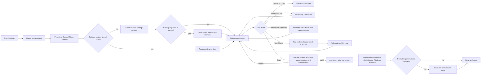
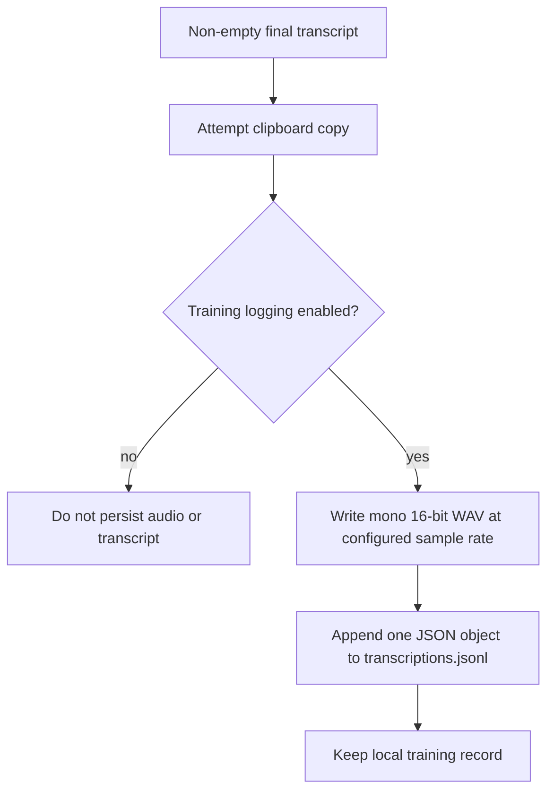

# Settings And Privacy

murmur exposes user-facing settings through the **Settings** item in the
system-tray menu. The window is owned by a persistent CustomTkinter UI thread;
the tray callback places a request on that thread instead of creating a second
independent UI loop. The same thread draws the optional
[recording overlay](pipeline.md#recording-overlay).

## Settings workflow



## Settings tabs

| Tab | Controls | Runtime effect |
| --- | --- | --- |
| General | Hotkey, microphone, keep microphone ready, recording overlay, notifications, Windows startup, media pause | Microphone preference applies at the next recording without restart. Hotkey registration and keeping the microphone ready require restart; the overlay, notifications, media pause, and startup settings apply without a restart. |
| VAD | Aggressiveness, speech padding, silence-to-stop duration | Applied to the VAD workers created for recordings; the UI requests a restart after changes. |
| Transcription | Whisper model, device, language, maximum recording duration | Used by startup-created recorder/transcriber components; restart after changes. |
| LLM Cleanup | Enablement, endpoint, model, timeout, preload, connection test | The final pass is optional; endpoint/model/preload changes require restart according to the UI notice. |
| Data Privacy | Training-data logging and delete action | Logging enablement applies to subsequent finalizations; deletion is immediate after confirmation. |
| Statistics | Local collection, refresh, CSV export, delete session history | Collection changes apply to the next session. Existing sessions retain their start-time choice. History is shared across worktrees under the same Windows account. |

Numeric controls have both a slider and an editable number field. Values are
clamped to the configured bounds when displayed or saved. Non-numeric or
non-finite input blocks Save, restores that field's persisted value in the UI,
and leaves `config.json` unchanged. Reset controls change only the current UI
state until Save is pressed.

Use Settings for normal configuration changes. It checks entries before saving
and tells you when a restart is required. The sample rate is an advanced setting
that defaults to 16,000 Hz and is not exposed in the window. See
[Advanced manual configuration](#advanced-manual-configuration) if you need to
change it.

**Microphone** offers System default and the available input devices. Refresh
reinitializes the audio backend and updates the list after plugging in a device.
If a recording is active, the refresh waits until its stream closes. Settings shows the saved preference
separately from the microphone currently in use, or the microphone that would
be tried next when no stream is open. If the preferred microphone is missing or
fails to open, Murmur tries the current Windows default and keeps the saved
preference. Reconnecting the preferred microphone does not interrupt a recording;
click Refresh after reconnecting, then try it at the next stream start. An
unexpected stream stop also queues a backend refresh after capture closes.
If neither input can open, Murmur reports an error and the hotkey remains usable
for another attempt after the input problem is fixed.

**Keep microphone ready** is off by default. Turn it on if the opening words get
cut off when you speak right after the hotkey. Murmur then keeps the microphone
open while it runs, so the Windows microphone indicator stays on. Idle audio is
discarded and never reaches VAD, transcription, or training-data logging. If
the microphone does not start within three seconds at launch, Murmur falls back
to opening it on each hotkey press. Refresh or an unplugged microphone closes
the idle stream, and the next recording reopens it. A new microphone choice
takes effect at the next hotkey press.

## Persistent configuration

The configuration file is `%APPDATA%\murmur\config.json`. murmur creates the
directory and file on first launch. Missing keys receive values from
`DEFAULT_CONFIG`. If the file is malformed, invalid UTF-8, or not a JSON object,
murmur copies it to a timestamped `config.corrupt-*.json` backup, writes defaults,
and keeps a repair notice for the next time you open Settings during that run.

Before runtime components start, murmur also checks the types and numeric ranges
of saved settings. Invalid fields return to their defaults while valid settings
and unknown keys are preserved. The original file is backed up using the same
`config.corrupt-*.json` naming pattern. A compact amber warning banner above the
Settings tabs names the repaired settings and their replacement values, even
when notifications are off.
It has only a **Dismiss** action. Closing Settings without dismissing the banner
keeps it for the next Settings visit during the same app run. Dismiss clears the
notice without saving or changing settings. The banner does not open Settings
automatically and does not offer configuration or backup folder links.

Training data logging requires the JSON boolean `true`; strings such
as `"false"` and numeric values do not enable it.
An invalid saved `ollama_enabled` value disables Ollama cleanup rather than
restoring its enabled default, so recovery cannot enable transcript delivery to
a configured endpoint. Missing values still use the normal default.

The active file stays in place until the replacement is written successfully,
so a failed repair can be retried on the next launch. Blank Ollama endpoint and
model fields are allowed while Ollama cleanup is disabled.

Saved sample rates must be integers from 8,000 to 96,000 Hz. Recording limits
must be finite numbers from 30 to 1,800 seconds; fractional seconds are supported.
VAD values and Ollama timeouts use the bounds shown in Settings. Out-of-range
saved values reset to defaults rather than being clamped.

### Advanced manual configuration

Prefer Settings for supported controls. If you need to edit `config.json`
directly, exit murmur first, edit the file, then relaunch. Closing only the
Settings window is not enough: murmur keeps configuration in memory and does
not reload external edits while running. A later Settings save can overwrite
manual edits made during that run. Invalid saved fields are repaired on launch
and the original file is backed up; review any repair banner in Settings.

The current default values are:

```json
{
  "hotkey": "ctrl+shift+space",
  "model": "small",
  "device": "cuda",
  "microphone": null,
  "keep_microphone_ready": false,
  "language": null,
  "sample_rate": 16000,
  "vad_aggressiveness": 1,
  "vad_padding_ms": 220,
  "vad_silence_duration_ms": 400,
  "max_recording_duration": 300,
  "enable_logging": false,
  "enable_statistics": true,
  "enable_notifications": false,
  "show_recording_overlay": true,
  "start_with_windows": true,
  "pause_media_while_recording": true,
  "logging_consent_updated_at": null,
  "logging_consent_source": null,
  "ollama_enabled": true,
  "ollama_endpoint": "http://localhost:11434",
  "ollama_model_name": "qwen3.5:4b",
  "ollama_timeout_seconds": 60,
  "ollama_preload_model": true
}
```

**Show recording overlay** and **Enable notifications** are independent. The
overlay is on by default; Windows toast notifications are off by default.
Turning the overlay off suppresses every overlay state, including errors, while
tray status and content-safe console messages remain.

The settings save operation writes a temporary file and replaces the config
atomically. Windows autostart is stored in the current user's
`Software\Microsoft\Windows\CurrentVersion\Run` key. A packaged app registers
its own `murmur.exe`; a Python install registers the same environment's
`pythonw.exe -m src`. Source development requires an editable install so the
module is available outside the checkout.

## Training-data logging

Logging is disabled by default and enabling it requires confirmation in the
privacy tab. murmur logs only when final text is non-empty and logging is
enabled. The logger runs after the clipboard attempt and writes:



Files are stored in `%APPDATA%\murmur\training_data\`:

```text
training_data/
├── audio/
│   └── YYYYMMDD_HHMMSS_microseconds.wav
└── transcriptions.jsonl
```

Each metadata record contains the timestamp, audio filename, final transcript,
recorded duration, configured model, finalization latency, and live-segment
metrics. `processing_time` measures from stop-time finalization start through
the clipboard attempt; it excludes the subsequent logging write. Live latency
values measure Whisper runtime for chunks that contributed text, not queue wait
or finalization time. If no live chunks contributed text, the count is `0` and
the latency fields are `null`.

The **Delete Logged Data** action displays a file count and approximate size,
asks for confirmation, then removes the logged WAV files and JSONL metadata.
Disabling logging stops future writes; it does not delete existing records.

## Local statistics

Statistics collection is enabled by default and stays on this computer. Open
**Settings > Statistics** to view all retained history, refresh it, export CSV,
or delete it. The view reports usage, delivery success, error-recovery fallback
rates, stage timings, and model/device comparisons with sample counts.

The database is `%APPDATA%\murmur\statistics.sqlite3`. Worktrees and installed
copies under the same Windows account share it. Normally one instance uses it;
an occasional second instance can write through SQLite's serialized transactions.
Each process owns one background database worker. A database error never blocks
microphone capture or clipboard delivery; a notice flags incomplete history.
Unsaved statistics may be lost. Collection retries on later sessions without a
durable replay queue.

Records include session/run IDs, timestamps, recording duration, final word
count, actual Whisper model and CPU/CUDA device, cleanup model and outcomes,
stage durations/attempt counts, categorized issue codes, recovery outcomes, and
code provenance. They do **not** contain audio, transcript text, prompts,
endpoints, microphone names, or raw error messages. Word count is computed in
memory by splitting the final text on whitespace; it is not an accuracy metric.
Individual audio segment records are not retained.

App version, full Git commit, and whether uncommitted changes were present
identify each run. Source identity is frozen at startup, using the running
package's repository rather than the current shell directory. Restart after
editing or changing commits for useful comparisons. Windows builds embed their
identity during build preparation. Plain wheels without embedded metadata and
unavailable Git information report unknown values rather than guessing.

**Save** applies a collection toggle to the next session. A session already
collecting finishes normally; enabling does not enroll an active session midway.
Disabling retains existing history. A run that starts with collection disabled
creates no statistics database. Another running instance needs a restart to
observe the saved toggle because configuration is held in each process.
Training-data logging remains independently opt-in. A malformed statistics
boolean repairs to off; whole-file config recovery restores defaults, including
default-on statistics, and displays a repair notice.

History is retained until explicitly deleted. **Delete Session History** asks
for confirmation and clears every session, stage timing, and issue count across
instances. A database generation check rejects old pending writes, so an active
session cannot restore deleted history. It keeps the list of app versions that
have run (one row per launch with app version, Git commit, and uncommitted-change
flag; no times or session details), training data, and previously exported CSV
files.

Each run holds a small lock file in `statistics.sqlite3.runs\`. Unfinished
sessions are marked interrupted on a later launch only when the owning run's
lock establishes that it exited; live or uncertain owners are preserved. A run
deletes its own lock file on clean exit when none of its sessions are
unfinished, and a later launch deletes lock files of exited runs once their
sessions are reconciled.

### Reading the measurements

- Success means non-empty text reached the clipboard. The success rate is
  successes divided by successes plus failures. Cancelled, no-speech,
  interrupted, and active sessions are shown separately and excluded.
- No captured frames without a capture error counts as no-speech. A startup or
  capture error with no usable audio counts as failed.
- Error-recovery fallback rate counts completed transcription attempts that
  entered an alternate transcription route because of an error or unavailable
  component. Empty-live and no-segment routes alone are normal routing counts.
  Cleanup recovery is shown separately. Clipboard success after recovery is
  still a successful session.
- Median and nearest-rank p95 use successful stop-to-clipboard waits. Timing
  begins before recorder stop and live worker draining, ends after clipboard
  delivery, and excludes later training-data logging and notifications.
- Recording length and inference work differ. Live work overlaps recording;
  stage durations must not be added to infer the user's total wait. Failed
  stage durations are reported separately from successful stage averages.
- Missing measurements remain unavailable, not zero. Small samples are flagged.
  Model comparisons include recording length and cleanup context; they measure
  observed performance, not transcription accuracy or causal improvement.

CSV export has one row per session, fixed headers, run provenance, and counted
issue codes encoded as deterministic JSON. Each pipeline stage has four
columns: `stage_<name>_outcome`, `stage_<name>_seconds` (total across
attempts), `stage_<name>_attempts`, and `stage_<name>_failed_count`. Durations
are rounded to milliseconds. Missing values become empty cells. Text values that
resemble spreadsheet formulas are escaped in the CSV file only, never in the
database. File formatting/writing occurs outside the database transaction and UI
thread. An empty history export writes no file.

## Vocabulary and network boundary

An optional `user_vocab.json` supplies preferred spellings to the Ollama prompt.
Source launches use the gitignored file in the repository root. Packaged
launches use `%APPDATA%\murmur\user_vocab.json` so the file remains writable and
survives replacement of the application folder. It is loaded lazily only when
the Ollama post-processor is built; it does not change Whisper's recognition and
is ignored when Ollama cleanup is disabled.

Whisper audio inference and the default Ollama endpoint are local. If
`ollama_endpoint` points to another machine, the final transcript sent for
cleanup leaves the local computer. The Ollama cleanup result is accepted only
when it remains transcript-like; otherwise murmur keeps the locally cleaned
text.

## Source map

- [`src/settings_gui.py`](https://github.com/laceyp99/murmur/blob/main/src/settings_gui.py): UI thread, validation, save,
  connection test, and deletion workflow.
- [`src/recording_overlay.py`](https://github.com/laceyp99/murmur/blob/main/src/recording_overlay.py): recording
  overlay states, timers, and window.
- [`src/settings_schema.py`](https://github.com/laceyp99/murmur/blob/main/src/settings_schema.py): tabs, defaults,
  bounds, and restart metadata.
- [`src/config.py`](https://github.com/laceyp99/murmur/blob/main/src/config.py): config path, defaults, recovery, and
  atomic persistence.
- [`src/logger.py`](https://github.com/laceyp99/murmur/blob/main/src/logger.py): opt-in WAV/JSONL storage and purge.
- [`src/user_vocab.py`](https://github.com/laceyp99/murmur/blob/main/src/user_vocab.py): vocabulary file handling.
