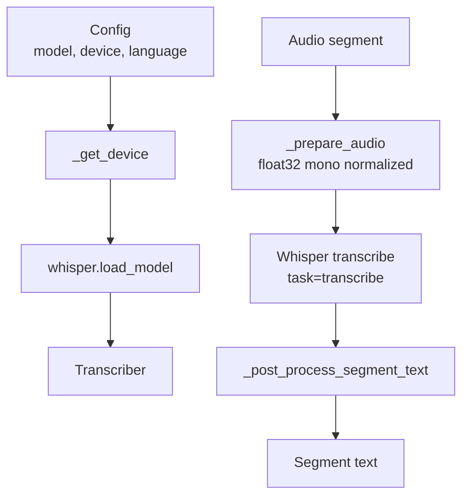
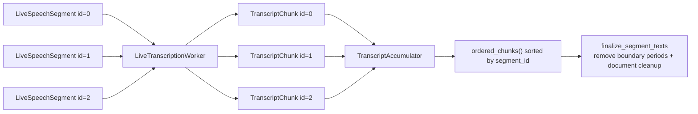
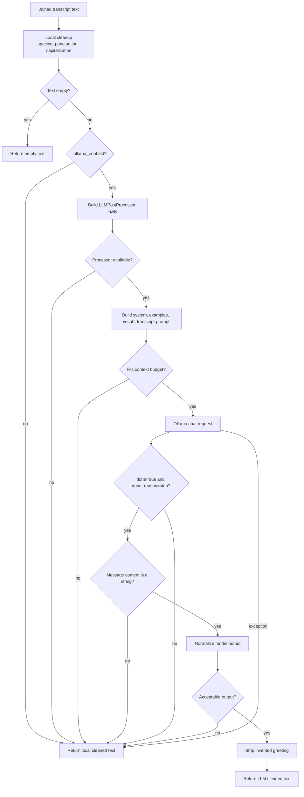

# Transcription And Cleanup

murmur uses Whisper for speech-to-text and an optional Ollama model—local by
default—for a single final cleanup pass. Segment transcription and document
cleanup are kept separate so the live path can transcribe chunks early without
asking the LLM to rewrite partial text.

## Whisper Model Ownership

`Transcriber` owns Whisper model loading, device selection, audio normalization,
segment transcription, and final document cleanup.

The live worker calls `transcribe_segment()`, which returns segment text without
document-level cleanup. The offline path calls `transcribe_segments()`, which
transcribes each segment, joins the text, and then calls `finalize_text()`.

The configured `device` selects CUDA only when it is requested and available;
otherwise `Transcriber` uses CPU. Whisper calls are made with `task="transcribe"`
and the configured language (or automatic detection when language is empty or
`null`). Before text is accepted, Whisper result segments with both metadata
fields are filtered when `no_speech_prob > 0.4` and `avg_logprob <= -0.6`.
Segments with missing filter metadata are retained.

## Live Accumulation

`TranscriptAccumulator` stores chunks by `segment_id` and returns them in sorted
order. This makes the output stable even if callback timing changes.

At stop time, `finalize_segment_texts()` joins the ordered live chunks and applies
document cleanup. The offline path uses the same cleanup. Joining skips empty
chunks, normalizes spacing, and removes trailing periods from nonfinal chunks
to reduce breaks caused by pauses. Casing and other punctuation are preserved,
as are periods inside chunks and at the end of the final chunk. Document cleanup
adds final punctuation when needed. Real sentence breaks and abbreviation periods
at nonfinal chunk endings are also removed; unwanted capitals can remain.

## Final Cleanup

Final cleanup has two layers:

1. Local cleanup in `Transcriber._post_process_document()`.
2. Optional Ollama cleanup in `LLMPostProcessor.process()`.

The Ollama processor is constructed lazily on the first finalization that needs
it. Startup warmup runs in the background after the hotkey registers. It only
checks for the configured installed model and attempts to load it into memory;
it does not download a missing model. If the client cannot be built, the
request fails, or the response fails the acceptance gate, the local cleanup
result is returned.

All configured models receive the same request profile: thinking disabled,
`num_ctx=4096`, temperature `0`, and a 10-minute keep-alive.

Before sending a request, murmur conservatively estimates the complete message
token count as the larger of words divided by `0.75` or characters divided by
`4`, rounded up. The output allowance is the largest of three tokens per input
word, input characters divided by `4` rounded up, or 64 tokens. The cleanup
instructions, transcript, and space reserved for the response must fit within
90% of the model's context window. The remaining 10% provides a buffer for
errors in our token estimates. Requests that exceed that budget bypass Ollama
and return the locally cleaned transcript. This fallback emits a
content-safe operational log message without transcript text or a desktop warning.

## Ollama Acceptance Gate

Before extracting text, the client requires `done=true` and `done_reason="stop"`
for both dictionary and SDK-object responses. Output-limit completion
(`done_reason="length"`), unfinished responses, and missing or unknown completion
metadata return the locally cleaned transcript through the existing failure
fallback. No partial model text is accepted or logged.

Message content must be a string for both dictionary and SDK-object responses.
Null and other non-string values are treated as empty output, so the existing
acceptance gate retains the locally cleaned Whisper transcript without logging
the response content.

The completed LLM output is accepted only if it still looks like transcript
text. The gate rejects output when it is:

- Empty.
- Prefixed with common assistant-style preambles.
- Much longer than the input.
- Markdown heading shaped.
- List shaped.
- Chat transcript shaped with labels such as `user:` or `assistant:`.

This is intentionally conservative. The LLM pass should improve punctuation,
capitalization, spacing, and obvious recognition mistakes, but it should not
turn dictated text into an answer, a list, or a rewritten document.

## Invented Greeting Guard

Accepted output passes through `strip_invented_greeting`, which removes invented
opening greetings to a name in `speaker_names` or bare greeting lines such as
`Hi,`. Dictated greetings and greetings to other people are kept; stripping
never leaves an empty result.

The dictation check skips filler such as `um` or `like` and accepts misheard
greetings such as `High Pat`. A known miss is `High priority...`, which can
preserve an invented bare greeting.

## Vocabulary Overrides

`user_vocab.json` is loaded lazily when the LLM post-processor is built. Entries
are included in the prompt as preferred vocabulary and corrections. This keeps
personal names and project-specific terms out of the codebase while still
allowing the local cleanup model to prefer them. Source launches read the file
from the repository root; packaged launches read it from
`%APPDATA%\murmur\user_vocab.json`.

## Implementation Map

| Concern | Code |
| --- | --- |
| Whisper model loading | [`src/transcription.py`](https://github.com/laceyp99/murmur/blob/main/src/transcription.py) |
| Segment transcription | [`src/transcription.py`](https://github.com/laceyp99/murmur/blob/main/src/transcription.py) |
| Live transcription queue | [`src/transcription_live.py`](https://github.com/laceyp99/murmur/blob/main/src/transcription_live.py) |
| Transcript ordering and metrics | [`src/transcription_live.py`](https://github.com/laceyp99/murmur/blob/main/src/transcription_live.py) |
| Ollama client wrapper | [`src/llm_postprocess.py`](https://github.com/laceyp99/murmur/blob/main/src/llm_postprocess.py) |
| LLM prompt and acceptance gate | [`src/llm_postprocess.py`](https://github.com/laceyp99/murmur/blob/main/src/llm_postprocess.py) |
| User vocabulary loading | [`src/user_vocab.py`](https://github.com/laceyp99/murmur/blob/main/src/user_vocab.py) |
